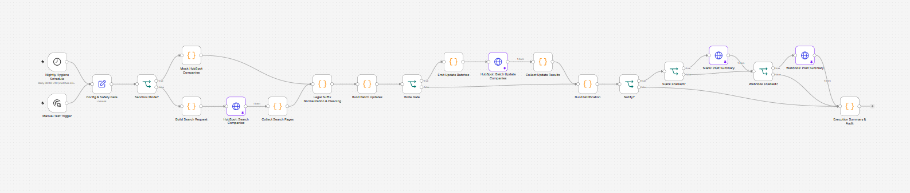

<div align="center">

# n8n-hubspot-company-legal-suffix-standardizer

**Data cleaning cron job that strips messy legal suffixes (e.g., LLC, Inc., Corp., GmbH) from HubSpot company names to ensure clean matching across external data providers.**

A dhRobin Systems Revenue Infrastructure blueprint

     

</div>

---

## Table of Contents

1. [Overview](#1-overview)
2. [Architecture and Data Flow](#2-architecture-and-data-flow)
3. [Repository Contents](#3-repository-contents)
4. [Prerequisites](#4-prerequisites)
5. [5-Minute Sandbox Quick Start](#5-5-minute-sandbox-quick-start)
6. [Step-by-Step Import and Configuration Guide](#6-step-by-step-import-and-configuration-guide)
7. [Environment Variables](#7-environment-variables)
8. [Node-by-Node Configuration Guide](#8-node-by-node-configuration-guide)
9. [Suffix Stripping Rules, Edge-Case Protections and Matching Logic](#9-suffix-stripping-rules-edge-case-protections-and-matching-logic)
10. [Safety Matrix](#10-safety-matrix)
11. [Data Protection and Compliance Checklist](#11-data-protection-and-compliance-checklist)
12. [Operations and Troubleshooting](#12-operations-and-troubleshooting)
13. [Disclaimer and License](#13-disclaimer-and-license)

---

## 1. Overview

"Northstar Logistics Inc.", "Northstar Logistics, Inc" and "NORTHSTAR LOGISTICS" are one company to a person and three companies to an enrichment provider, a dedupe tool, or an ABM platform matching on name. Legal suffixes are the biggest single source of that noise, and they come in dozens of forms: dotted or not, stacked ("Holdings, LLC"), and different in every jurisdiction ("Co., Ltd.", "S.A. de C.V.", "GmbH & Co. KG", "Sp. z o.o.").

I built this workflow to remove that noise without damaging the names it touches. Every night it reads companies changed in HubSpot, strips trailing legal forms with brand-safe rules, and writes the result to a dedicated property. It produces four outputs per company:

| Output | Example for `"Global Tech Holdings, LLC"` |
|---|---|
| `cleaned_name` | `Global Tech` |
| `extracted_suffixes` | `["Holdings", "LLC"]` |
| `was_modified` | `true` |
| `match_key` | `globaltech` (lower-case, letters and digits only, diacritics folded) |

**Design principles**

| Principle | Implementation |
|---|---|
| Safe by default | With no environment variables set, the workflow makes **zero HubSpot calls and writes nothing**. Writing needs `SANDBOX_MODE=false`, `DRY_RUN=false` **and** `WRITE_TO_HUBSPOT=true`. |
| Preserve the original | The cleaned name goes to `clean_company_name`. `name` is untouched unless `OVERWRITE_NAME=true`, and then only after the original is copied to `legal_name_original`. |
| Brand-safe matching | Only whole tokens at the **end** of a name are removed. Short forms that are also ordinary words (Spa, SA, AG, PC …) need legal formatting. A strip that would leave nothing meaningful is refused. |
| Write only what changed | Unmodified names and values already in HubSpot are skipped. Updates go out in batches of ≤ 100, one request per second. |
| Guardrails | Overwrite without a backup property is blocked, a circuit breaker stops runs that would overwrite an unusual share of names, and `MAX_UPDATES_PER_RUN` caps each run. |
| Secrets out of data | The HubSpot token and webhook URLs appear only as `{{ $env.* }}` in HTTP header and URL fields. No Code node reads a secret. |

---

## 2. Architecture and Data Flow

```mermaid
flowchart LR
    SCH[Nightly Hygiene Schedule<br/>02:40 UTC] --> CFG
    MAN[Manual Test Trigger] --> CFG[Config & Safety Gate]
    CFG --> SB{Sandbox Mode?}
    SB -- yes --> MOCK[Mock HubSpot Companies<br/>sample-payloads/hubspot-companies.json]
    SB -- no --> BSR[Build Search Request<br/>modified_since · backfill · unprocessed] --> HS[HubSpot: Search Companies<br/>paginated, 100/page] --> CSP[Collect Search Pages]
    MOCK --> CL
    CSP --> CL[Legal Suffix Normalization & Cleaning<br/>cleaned_name · extracted_suffixes · was_modified · match_key]
    CL --> BBU[Build Batch Updates<br/>modified only · preserve/overwrite · guards]
    BBU --> WG{Write Gate<br/>!sandbox · !dry run · WRITE_TO_HUBSPOT}
    WG -- yes --> EB[Emit Update Batches] --> BU[HubSpot: Batch Update Companies<br/>≤ 100 per request, 1/s] --> CUR[Collect Update Results] --> NOTE
    WG -- no --> NOTE[Build Notification]
    NOTE --> NT{Notify?}
    NT -- no --> AUD
    NT -- yes --> SE{Slack Enabled?}
    SE -- yes --> SL[Slack: Post Summary] --> WE
    SE -- no --> WE{Webhook Enabled?}
    WE -- yes --> WH[Webhook: Post Summary] --> AUD
    WE -- no --> AUD[Execution Summary & Audit<br/>advances backfill cursor]
```





### Stage contracts

| Stage | Output shape |
|---|---|
| Mock HubSpot Companies / Collect Search Pages | `{ source, scope, total, companies: [{ id, properties }], maxId, moreAvailable, searchCapReached }` |
| Legal Suffix Normalization & Cleaning | `{ counts{ scanned, modified, suffix_removed, whitespace_normalized, already_clean, protected, no_name, too_short }, records: [{ id, original_name, cleaned_name, extracted_suffixes[], was_modified, match_key, status, refused[], current{} }] }` |
| Build Batch Updates | `{ counts, updates[{ id, properties, before, after, suffixes }], skipped[{ id, reason }], deferred[], blocked, batches[{ batchNo, ids, body{ inputs[] } }], writeAllowed, samples[] }` |
| Collect Update Results | `{ results[{ batchNo, records, ok, updated, error }], updated, failedBatches }` |
| Execution Summary & Audit | Outcome, safety flags, target properties, source stats, backfill cursor, counts, every change (before/after/suffixes), skips, refused strips, batch results, notification results |

---

## 3. Repository Contents

```
n8n-hubspot-company-legal-suffix-standardizer/
├── README.md                          Technical documentation (this file)
├── workflow.json                      Importable n8n workflow with sticky notes and pinned synthetic payloads
├── DISCLAIMER.md                      Liability limitation and usage terms
├── LICENSE                            MIT License
└── sample-payloads/
    └── hubspot-companies.json         24 synthetic companies in the CRM search response shape
```

All company names and IDs are fictitious.

---

## 4. Prerequisites

| Requirement | Detail |
|---|---|
| n8n | Self-hosted **1.60 or later** (Schedule Trigger 1.2, Set 3.4, IF 2, Code 2, HTTP Request 4.2 with pagination, `$('Node').isExecuted`, `v1` execution order). |
| Env access | `N8N_BLOCK_ENV_ACCESS_IN_NODE=false`, so `{{ $env.* }}` expressions resolve. |
| HubSpot private app | Scopes **`crm.objects.companies.read`** and **`crm.objects.companies.write`**. Create it under *Settings → Integrations → Private Apps*, and use its access token as `HUBSPOT_ACCESS_TOKEN`. |
| HubSpot properties | Company properties (single-line text) you create first: **`clean_company_name`** (`CLEAN_NAME_PROPERTY`), **`legal_name_original`** (`RAW_NAME_PROPERTY`, needed for overwrite mode), and optionally **`company_match_key`** (`MATCH_KEY_PROPERTY`). A batch that references a missing property is rejected by HubSpot as a whole. |
| Slack / webhook (optional) | An incoming webhook URL, and/or any JSON endpoint. |

> **n8n Cloud:** you can't define your own environment variables there. Replace each `$env.X` with `$vars.X` (on plans with Variables). The workflow logic is unchanged.

---

## 5. 5-Minute Sandbox Quick Start

1. **Run n8n locally:**
   ```bash
   docker run -it --rm -p 5678:5678 \
     -e N8N_BLOCK_ENV_ACCESS_IN_NODE=false \
     -e GENERIC_TIMEZONE=UTC \
     -v n8n_data:/home/node/.n8n \
     docker.n8n.io/n8nio/n8n
   ```
2. **Import** `workflow.json` (*Workflows → Import from File*).
3. Click **Test workflow** on *Manual Test Trigger*.
4. Open **Legal Suffix Normalization & Cleaning**, **Build Batch Updates** and **Execution Summary & Audit**.

**Expected sandbox result** (24 synthetic companies, no HubSpot call, nothing written):

| Original name | `cleaned_name` | `extracted_suffixes` | Note |
|---|---|---|---|
| Acme Cloud Solutions, LLC | Acme Cloud Solutions | LLC | Trailing comma removed |
| Northstar Logistics Inc. | Northstar Logistics | Inc. | |
| Bavaria Precision Engineering GmbH | Bavaria Precision Engineering | GmbH | |
| Apex Global Holdings Ltd. | Apex Global | Holdings, Ltd. | Stacked: legal form + descriptor |
| Incredible Foods | Incredible Foods | — | "Inc" inside a word is never touched |
| Global Tech Holdings, LLC | Global Tech | Holdings, LLC | Stacked with comma |
| Coastline Co. | Coastline | Co. | |
| Harbor & Co. | Harbor | & Co. | Connector removed with the suffix |
| Lumière Optique S.A.S. | Lumière Optique | S.A.S. | Accents kept; `match_key` `lumiereoptique` |
| Kiwi Orchard Pty Ltd | Kiwi Orchard | Pty Ltd | Multi-token form |
| Rotterdam Freight B.V. | Rotterdam Freight | B.V. | |
| Andes Mining S.A. de C.V. | Andes Mining | S.A. de C.V. | LATAM multi-token form |
| Bella Spa | Bella Spa | — | Ambiguous "Spa" not in legal form → kept |
| Milano Tessile S.p.A. | Milano Tessile | S.p.A. | |
| Clearbrook Analytics | Clearbrook Analytics | — | Already clean |
| The Group | The Group | — | Refused: nothing meaningful would remain |
| Summit Legal Partners LLP | Summit Legal Partners | LLP | |
| `␣␣pinecrest␣␣␣dental, p.c.␣␣` | pinecrest dental | p.c. | Whitespace collapsed, lower case preserved |
| Corporate Travel Experts | Corporate Travel Experts | — | "Corp" prefix of a word is never touched |
| Orion Data Corp, Inc. | Orion Data | Corp, Inc. | Two legal forms stacked |
| Tokyo Robotics Co., Ltd. | Tokyo Robotics | Co., Ltd. | APAC form |
| Wisła Software Sp. z o.o. | Wisła Software | Sp. z o.o. | `match_key` `wislasoftware` |
| Delta Freight LLC | Delta Freight | LLC | `clean_company_name` already set → skipped (`already_current`) |
| *(empty)* | — | — | Skipped (`no_name`) |

Totals: 24 scanned, 18 modified, 17 updates prepared in 1 batch, 7 skipped. Outcome `updates_found_sandbox`.

---

## 6. Step-by-Step Import and Configuration Guide

Each step changes one thing and has an exit check.

| Step | Configuration | Exit check |
|---|---|---|
| **1. Import and sandbox** | Defaults | The table in [§5](#5-5-minute-sandbox-quick-start) is reproduced. |
| **2. Create properties** | In HubSpot: `clean_company_name`, `legal_name_original`, optionally `company_match_key` (single-line text, company object) | Properties visible on a company record. |
| **3. Pinned live path** | `SANDBOX_MODE=false`, `HUBSPOT_ACCESS_TOKEN=synthetic`, `DRY_RUN=false`, `WRITE_TO_HUBSPOT=true`, `NOTIFY_CHANNELS=slack,webhook`, any `SLACK_WEBHOOK_URL` / `ALERT_WEBHOOK_URL`. Run **Test workflow** | Every node runs on pinned synthetic responses, `outcome: updated`. No request reaches HubSpot or Slack. |
| **4. Live read, dry run** | Unpin *HubSpot: Search Companies* (*right-click → Unpin*). Real token, `DRY_RUN=true`, `SEARCH_SCOPE=modified_since`, `LOOKBACK_HOURS=720` | Review every row of `changes` and `refusedStrips` in the audit. Add brand names that must not change to `PROTECTED_NAMES`. |
| **5. First write, preserve mode** | Unpin *HubSpot: Batch Update Companies*. `DRY_RUN=false`, `WRITE_TO_HUBSPOT=true`, `BATCH_LIMIT=50` | `clean_company_name` set on 50 or fewer companies, and `name` unchanged. |
| **6. Backfill** | `SEARCH_SCOPE=backfill`, `BATCH_LIMIT=2000`, activate the workflow (the cursor only moves in production runs) | Each night continues after the highest company ID processed. The audit shows `backfillCursor.advanced: true`. |
| **7. Nightly incremental** | `SEARCH_SCOPE=modified_since`, `LOOKBACK_HOURS=25` | New and edited companies are cleaned within a day. |
| **8. Overwrite (optional)** | `OVERWRITE_NAME=true`, `RAW_NAME_PROPERTY=legal_name_original`, conservative `MAX_CHANGE_RATIO` | `name` holds the clean name and the original is kept in `legal_name_original`. Agree this with whoever owns legal or billing names in HubSpot first. |

> **Before overwriting `name`,** check where it's used: invoice or quote templates, contracts, integrations that sync `name` to finance systems, and workflows that branch on it. Preserve mode with a dedicated property is the right choice for most portals; point enrichment tools at `clean_company_name` or `company_match_key`.

---

## 7. Environment Variables

All variables are optional. Unset values resolve to the safest behaviour.

### 7.1 Safety gate

| Variable | Default | Effect |
|---|---|---|
| `SANDBOX_MODE` | `true` | Synthetic companies. No HubSpot or notification calls. |
| `DRY_RUN` | `true` | Cleaning and payloads only, nothing written. |
| `WRITE_TO_HUBSPOT` | `false` | Explicit opt-in for batch updates. Effective only with `SANDBOX_MODE=false` and `DRY_RUN=false`. |
| `OVERWRITE_NAME` | `false` | `true` writes the cleaned name into `name` (and the original into `RAW_NAME_PROPERTY`). |
| `ALLOW_OVERWRITE_WITHOUT_BACKUP` | `false` | Allow `OVERWRITE_NAME=true` with an empty `RAW_NAME_PROPERTY`. Not recommended. |
| `MAX_CHANGE_RATIO` | `0.8` | Overwrite mode only: block the run if more than this share of scanned names (with ≥ 20 scanned) would be overwritten. |
| `MAX_UPDATES_PER_RUN` | `1000` | Cap per run. The rest are reported as deferred. |

### 7.2 Source and scope

| Variable | Default | Effect |
|---|---|---|
| `HUBSPOT_ACCESS_TOKEN` 🔒 | — | Private app token (`Authorization: Bearer`). |
| `HUBSPOT_API_BASE_URL` | `https://api.hubapi.com` | API base URL. |
| `SEARCH_SCOPE` | `modified_since` | `modified_since`, `backfill` or `unprocessed` ([§8.2](#82-source-and-pagination)). |
| `LOOKBACK_HOURS` | `25` | Window for `modified_since`. |
| `BACKFILL_START_AFTER_ID` | — | Starting `hs_object_id` for the first backfill run (when no cursor is stored). |
| `BATCH_LIMIT` | `500` (1–10000) | Companies scanned per run (100 per search page). |

### 7.3 Target properties and cleaning

| Variable | Default | Effect |
|---|---|---|
| `CLEAN_NAME_PROPERTY` | `clean_company_name` | Internal name of the property that receives `cleaned_name`. |
| `RAW_NAME_PROPERTY` | `legal_name_original` | Internal name of the backup property for the original name (overwrite mode). Written only if empty. |
| `MATCH_KEY_PROPERTY` | — | Optional property for `match_key`. |
| `WRITE_UNCHANGED` | `false` | Also write companies whose name needs no change, so every company gets `clean_company_name` / `match_key`. |
| `STRIP_DESCRIPTORS` | `true` | Also strip Holdings, Holding, Group, Company at the end. |
| `PROTECTED_NAMES` | — | Pipe-separated exact names never modified, e.g. `Vinyl LP|The Holding Company`. |
| `MIN_CLEAN_LENGTH` | `2` | Minimum length of a cleaned name. Shorter results keep the original. |
| `MATCH_KEY_DROP_LEADING_THE` | `true` | Drop a leading "The" from `match_key`. |

### 7.4 Throughput and notifications

| Variable | Default | Effect |
|---|---|---|
| `UPDATE_BATCH_SIZE` | `100` (1–100) | Inputs per batch/update request (HubSpot's maximum is 100). |
| `NOTIFY_CHANNELS` | `slack` | `slack`, `webhook` or both. A channel is active only when its URL is set. |
| `SLACK_WEBHOOK_URL` 🔒 | — | Slack incoming webhook. |
| `ALERT_WEBHOOK_URL` 🔒 | — | Generic JSON webhook. |
| `ALERT_WEBHOOK_TOKEN` 🔒 | — | Bearer token for the alert webhook. |
| `NOTIFY_SAMPLE_SIZE` | `8` (0–25) | Before → after samples in notifications. |
| `NOTIFY_ON_EVERY_RUN` | `false` | By default, notifications go out only when there are updates, blocks or failures. |

Property names are validated as HubSpot internal names (`^[a-z][a-z0-9_]*$`). An invalid value is treated as unset. 🔒 = secret. Inject from a secret manager, never commit.

### 7.5 Sample `.env` (staging)

```bash
# n8n runtime
N8N_BLOCK_ENV_ACCESS_IN_NODE=false

# Safety gate: live reads, nothing written yet
SANDBOX_MODE=false
DRY_RUN=true
WRITE_TO_HUBSPOT=false
OVERWRITE_NAME=false

# Scope
SEARCH_SCOPE=modified_since
LOOKBACK_HOURS=25
BATCH_LIMIT=500

# Target properties
CLEAN_NAME_PROPERTY=clean_company_name
RAW_NAME_PROPERTY=legal_name_original
MATCH_KEY_PROPERTY=company_match_key
PROTECTED_NAMES=

# Secrets (inject from your secret manager; never commit)
HUBSPOT_ACCESS_TOKEN=
SLACK_WEBHOOK_URL=
```

---

## 8. Node-by-Node Configuration Guide

### 8.1 Triggers and Config & Safety Gate

- **Nightly Hygiene Schedule** runs at 02:40 UTC. With `LOOKBACK_HOURS=25`, consecutive runs overlap by an hour, so nothing falls between them.
- **Config & Safety Gate** validates property names, clamps numbers and sets `writeToHubspot` only when all three safety conditions hold.

### 8.2 Source and pagination

**Build Search Request** creates a `POST /crm/v3/objects/companies/search` body with `name` `HAS_PROPERTY`, sorted by `hs_object_id` ascending, 100 per page, requesting `name`, `hs_lastmodifieddate` and the configured target properties.

| `SEARCH_SCOPE` | Extra filter | Use |
|---|---|---|
| `modified_since` | `hs_lastmodifieddate ≥ now − LOOKBACK_HOURS` | Nightly incremental |
| `backfill` | `hs_object_id > cursor` | Walking the whole portal, `BATCH_LIMIT` companies per run |
| `unprocessed` | `CLEAN_NAME_PROPERTY` `NOT_HAS_PROPERTY` | Filling gaps. Combine with `WRITE_UNCHANGED=true`, otherwise already-clean names come back every run. |

**HubSpot: Search Companies** paginates with the `after` cursor from `paging.next.after`, up to ⌈`BATCH_LIMIT` / 100⌉ pages, 250 ms apart. That respects the search API's per-second limit. HubSpot's search returns at most 10,000 results per query, which is why `backfill` moves an ID cursor instead of paging further.

**Backfill cursor:** stored in workflow static data. It's advanced by the audit node to the highest scanned ID, and only after a production run with writes enabled and nothing blocked, failed or deferred. Manual and dry runs never move it.

### 8.3 Legal Suffix Normalization & Cleaning

Implements [§9](#9-suffix-stripping-rules-edge-case-protections-and-matching-logic). Every record carries `status`: `suffix_removed`, `whitespace_normalized`, `already_clean`, `protected_name`, `no_name` or `too_short_after_clean`. It also carries `refused[]`, the suffix candidates that were deliberately not stripped and why.

### 8.4 Build Batch Updates

| Mode | Properties written for a modified company |
|---|---|
| Preserve (default) | `CLEAN_NAME_PROPERTY` ← `cleaned_name` |
| Overwrite | `name` ← `cleaned_name`; `RAW_NAME_PROPERTY` ← original (only if empty); `CLEAN_NAME_PROPERTY` ← `cleaned_name` (if configured) |
| Either | `MATCH_KEY_PROPERTY` ← `match_key` (if configured) |

Skip reasons: `unchanged` (unless `WRITE_UNCHANGED=true`), `already_current`, `no_name`, `protected_name`, `too_short_after_clean`. A non-null `blocked` (overwrite without backup, or circuit breaker) prevents all writes for the run.

### 8.5 HubSpot: Batch Update Companies

`POST /crm/v3/objects/companies/batch/update` with `{ "inputs": [{ "id", "properties" }] }`, at most 100 inputs per request and one request per second, with retries on transient errors. HubSpot rejects a whole batch if any input is invalid (for example, a property that doesn't exist), so **Collect Update Results** reports failures per batch with HubSpot's message.

### 8.6 Notifications and audit

**Build Notification** creates one Slack message (mode, scope, target, counts, sample before → after with removed suffixes, blocks, failed batches, more-available hint) and one webhook document (`event: "hubspot.company_names.standardized"`).

**Execution Summary & Audit** outcomes: `no_companies`, `nothing_to_update`, `writes_blocked`, `updates_found_sandbox`, `updates_found_dry_run`, `updates_found_write_disabled`, `updated`, `updated_more_pending`, `updated_partially`, `update_failed`. The audit lists every change with the properties written. Keep it, or route it to your log store, as the change record.

---

## 9. Suffix Stripping Rules, Edge-Case Protections and Matching Logic

### 9.1 Pre-processing

1. Non-breaking and repeated whitespace collapsed to single spaces, then trimmed.
2. Case is **never** changed: "pinecrest dental, p.c." becomes "pinecrest dental".

### 9.2 Tail matching

1. The name is split into tokens. From the end, the longest tail phrase (up to 6 tokens) whose **compact form** (lower case, without dots, commas and spaces) is a known suffix is removed.
2. This repeats up to 5 times, so stacked forms come off one by one: "Orion Data Corp, Inc." → "Orion Data Corp" → "Orion Data".
3. After each removal, a dangling connector (`&`, `and`, `und`, `et`, `y`, `-`) and trailing punctuation (`,` `;` `:` `-` `/`) are removed.
4. Only the tail is examined, so a suffix at the start or middle of a name is never removed.

### 9.3 Recognised legal forms (compact forms in parentheses where helpful)

| Region | Forms |
|---|---|
| US | LLC / L.L.C., Inc. / Incorporated, Corp. / Corporation, Co. / & Co., Ltd. / Limited, LLP, LLLP, LP, PC / P.C., PLLC, PA |
| UK / IE / Commonwealth | PLC, CIC, Ltd, Limited, Pty / Pty Ltd, Pvt Ltd / Private Limited, Pte Ltd, Sdn Bhd, Bhd, NL |
| DACH / Nordics / Benelux | GmbH, GmbH & Co. KG, AG, KG, KGaA, OHG, UG, eG, e.V., SE, B.V., N.V., BVBA, VOF, C.V., AB, AS / ASA, ApS, Oy / Oyj |
| France / Iberia / Italy | S.A., S.A.S., SASU, SARL, EURL, SCA, SNC, S.L., SLU, S.R.L., SRLS, S.p.A., SApA, S.c.a.r.l., Lda |
| LATAM | S.A. de C.V., S. de R.L. de C.V., S.R.L. de C.V., S.A.P.I. de C.V., Ltda., EIRELI, ME, EPP, S.A.A., S.A.C. |
| CEE | Sp. z o.o., s.r.o., a.s., d.o.o., Kft., Zrt., Nyrt., AD, OOD, EOOD |
| APAC | Co., Ltd., K.K., G.K., Y.K., PT, Tbk, JSC / OJSC |
| Descriptors (`STRIP_DESCRIPTORS`) | Holdings, Holding, Group, Company |

### 9.4 Edge-case protections

| Protection | Rule | Example |
|---|---|---|
| Whole tokens only | A suffix must be a separate token at the end | "Incredible Foods", "Corporate Travel Experts", "Limited Edition Coffee", "Group Therapy" unchanged |
| Ambiguous short forms | `spa, sa, as, ab, ag, kg, se, sl, oy, bv, nv, pc, lp, pa, nl, cv, ad, me, eg, ev, ug, pt, sp, kk, gk, yk, sas, sac, epp, doo, sapi` are stripped only with dots ("S.p.A."), in capitals in a mixed-case name ("Casa Bonita SA"), or in canonical case ("SpA", "GmbH", "Oy") | "Bella Spa", "Delta Me", "Scooby Doo" unchanged; "BELLA SPA" (all capitals) unchanged |
| Core-name guard | A strip is refused if the remainder has no token of 2+ letters or digits outside stop words (the, and, of, de, la …) | "The Group", "The Company", "Inc." unchanged |
| Minimum length | Results shorter than `MIN_CLEAN_LENGTH` keep the original | — |
| Protected names | Exact names in `PROTECTED_NAMES` are never modified | — |
| No empty writes | Empty or missing names are skipped | — |

> **Known limits:** a capitalised `LP` or `PC` at the end is treated as a legal form, so "Vinyl LP" becomes "Vinyl". Add such brands to `PROTECTED_NAMES`. Prefix forms ("PT Example Tbk" keeps the leading "PT", "株式会社 Example" is unchanged) and trailing qualifiers in parentheses ("Acme Ltd (UK)") aren't stripped. Descriptors are part of some brand names; set `STRIP_DESCRIPTORS=false` if your portal relies on them.

### 9.5 Matching key

`match_key` is built from `cleaned_name`:

1. Unicode NFKD, with combining marks removed (é → e, ü → u). Then ł → l, ø → o, ß → ss, æ → ae, œ → oe.
2. Lower case, `&` and `+` → `and`.
3. A leading `the` is removed (`MATCH_KEY_DROP_LEADING_THE`).
4. Everything except letters and digits removed (non-Latin letters are kept).

"Acme Cloud Solutions, LLC", "ACME CLOUD SOLUTIONS INC" and "Acme Cloud Solutions" all produce `acmecloudsolutions`. Use it as the join key when matching HubSpot companies against enrichment provider records cleaned the same way.

---

## 10. Safety Matrix

| `SANDBOX_MODE` | `DRY_RUN` | `WRITE_TO_HUBSPOT` | `OVERWRITE_NAME` | HubSpot search | Writes | Field written |
|:---:|:---:|:---:|:---:|:---:|:---:|:---:|
| `true` *(default)* | any | any | any | No (fixture) | No | — |
| `false` | `true` *(default)* | any | any | Yes | No | — |
| `false` | `false` | `false` *(default)* | any | Yes | No | — |
| `false` | `false` | `true` | `false` *(default)* | Yes | **Yes** | `clean_company_name` (+ match key) |
| `false` | `false` | `true` | `true` | Yes | **Yes**, unless blocked | `name` + `legal_name_original` backup |

**Pinned data:** pins apply only to manual executions. Scheduled production runs always call HubSpot according to this matrix. The batch-update pin covers one batch. With more batches, the count guard stops the run instead of misreporting. Unpin both HubSpot nodes before a manual live test.

---

## 11. Data Protection and Compliance Checklist

Company names are business data. They become personal data when a company is a sole trader or is named after a person ("Jordan Lee Consulting LLC"), so treat them with the same care as contact records.

- [ ] **Least privilege:** the private app has only `crm.objects.companies.read` and `crm.objects.companies.write`.
- [ ] **Preserve first:** run in preserve mode until the audit has been reviewed. Overwrite only with a backup property and a conservative `MAX_CHANGE_RATIO`.
- [ ] **Downstream impact reviewed:** `name` isn't used by invoicing, contracts, finance syncs or workflows that would break if the legal form disappeared.
- [ ] **Change record kept:** the audit lists every change with before and after values. Retain it according to your record-keeping policy.
- [ ] **Execution data restricted:** executions contain company names. Restrict access and enable pruning (`EXECUTIONS_DATA_PRUNE=true`, a short `EXECUTIONS_DATA_MAX_AGE`).
- [ ] **Secrets** (`HUBSPOT_ACCESS_TOKEN`, webhook URLs and token) are injected from a secret manager and rotated if an execution export leaves your team.
- [ ] **Notifications:** Slack samples contain company names. Post to a channel limited to RevOps.
- [ ] **Version control hygiene:** before committing an edited workflow, run:

```bash
grep -nE '(pat-[a-z0-9]{2}-[a-f0-9-]{20,}|hooks\.slack\.com/services/[A-Z0-9]+/|Bearer [A-Za-z0-9._-]{20,})' workflow.json && echo "Possible secret found" || echo "Clean"
```

---

## 12. Operations and Troubleshooting

### 12.1 Call volume per run

| Calls | Count |
|---|---|
| Search | ⌈companies scanned / 100⌉ (≤ 4 per second) |
| Batch update | ⌈updates / `UPDATE_BATCH_SIZE`⌉ (1 per second) |
| Slack / webhook | ≤ 1 each |

A 500-company nightly run with 120 changes uses 5 search calls and 2 update calls.

### 12.2 Troubleshooting

| Symptom | Likely cause | Fix |
|---|---|---|
| `HubSpot search failed: 401` | Wrong or rotated token | Check `HUBSPOT_ACCESS_TOKEN`. |
| `HubSpot search failed: 400` | `SEARCH_SCOPE=unprocessed` with a property that doesn't exist | Create `CLEAN_NAME_PROPERTY` in HubSpot. |
| Batch failed: `Property "clean_company_name" does not exist` | Target property not created | Create it ([§4](#4-prerequisites)), then re-run. |
| `writes_blocked: overwrite_without_backup` | `OVERWRITE_NAME=true` without `RAW_NAME_PROPERTY` | Set `RAW_NAME_PROPERTY`, or knowingly set `ALLOW_OVERWRITE_WITHOUT_BACKUP=true`. |
| `writes_blocked: circuit_breaker` | Unusually many names would be overwritten (first backfill, or a rule change) | Review the audit. If expected, raise `MAX_CHANGE_RATIO` for that run. |
| A brand name was shortened | Trailing token matches a legal form | Add it to `PROTECTED_NAMES`, or set `STRIP_DESCRIPTORS=false` for descriptor cases. If written, restore from `legal_name_original` or the audit. |
| `updated_more_pending` | More updates than `MAX_UPDATES_PER_RUN` | Normal on large portals. The next run continues. |
| Backfill doesn't progress | Manual or dry runs, or a blocked or failed run | The cursor only advances after a clean production write run. |
| Same companies every night in `unprocessed` scope | Clean names never receive the property | Set `WRITE_UNCHANGED=true`, or use `modified_since`. |
| `429` | HubSpot rate limit | The HTTP nodes retry. Lower `BATCH_LIMIT` or raise the batch interval. |

---

## 13. Disclaimer and License

### ⚠️ Disclaimer & Liability Limitation

**Use at your own risk.** The code, workflows, and scripts in this repository (`n8n-hubspot-company-legal-suffix-standardizer`) are provided for educational and architectural demonstration purposes.

- **No Liability:** The author and dhRobin Systems accept no responsibility or liability for any direct, indirect, incidental, or consequential damages that result from using, misusing, or deploying these scripts.
- **No Warranty:** All software, n8n JSON blueprints, JavaScript modules and prompts are provided "AS IS", without warranty of any kind, express or implied. This includes, but is not limited to, warranties of merchantability, fitness for a particular purpose, and non-infringement.
- **Production Testing Required:** Always test thoroughly in an isolated staging environment, such as a HubSpot developer test account or sandbox, with `SANDBOX_MODE=true`, `DRY_RUN=true` and `WRITE_TO_HUBSPOT=false` enabled, before you connect live HubSpot credentials. Treat every cleaned name as a proposed change that a person must be able to review and reverse, especially before overwriting the `name` property.
- **Third-Party APIs & Compliance:** You alone are responsible for complying with the terms of service, rate limits, data privacy regulations (GDPR/CCPA), and security policies of HubSpot, Slack and any connected services. That includes granting only the required private app scopes, keeping an original copy of every overwritten name, checking legal, billing and integration uses of company names before changing them, securing every token and webhook URL, and reviewing every automatically updated record.

The full disclaimer is also available in [DISCLAIMER.md](DISCLAIMER.md).

### License

Released under the MIT License. Copyright (c) 2026 DH Robin (dhRobin Systems). See [LICENSE](LICENSE).

---

Full text: DISCLAIMER.md · Licensed under the MIT License. License: MIT © 2026 dhRobin Systems · Provided as-is, see the disclaimer.
